# Type 2 Diabetes Prediction

An educational FastAPI application that estimates type 2 diabetes status from nine numeric health measurements.

[](#) [](#) [](#) [](#) [](#)

Live demo: [LIVE_DEMO_URL_TODO](LIVE_DEMO_URL_TODO)

<!-- Replace LIVE_DEMO_URL_TODO with the deployed application URL. -->
<!-- TODO: generate the referenced image files in docs/images before publishing. -->

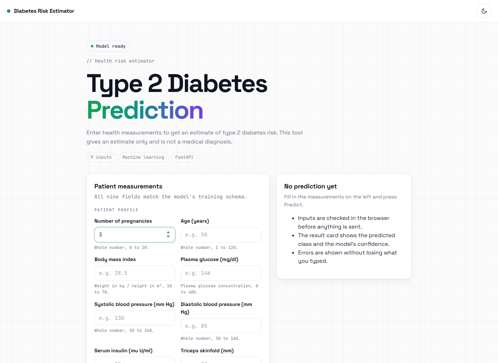

| Light theme | Dark theme |
| --- | --- |
| 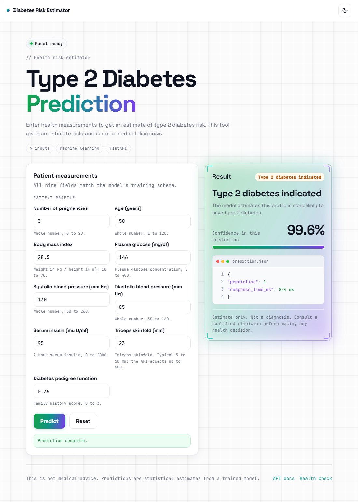 | 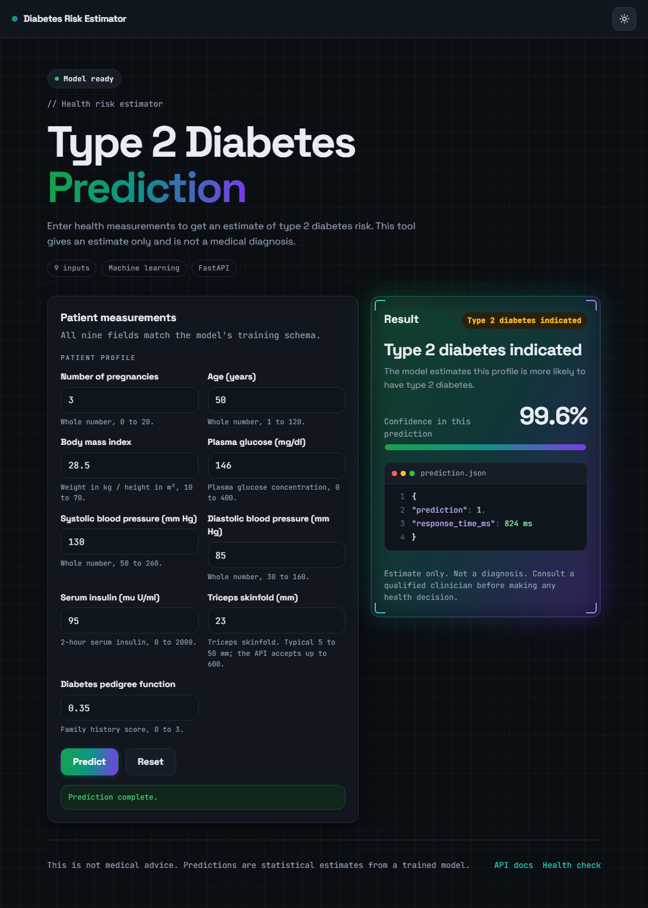 |

## The problem

The tool estimates whether a patient record is labelled as type 2 diabetic in the training data. It is intended for learning, experimentation and demonstration by students, developers and data science practitioners. This is an educational project and not medical advice. It must not be used for diagnosis or treatment decisions.

## How it works

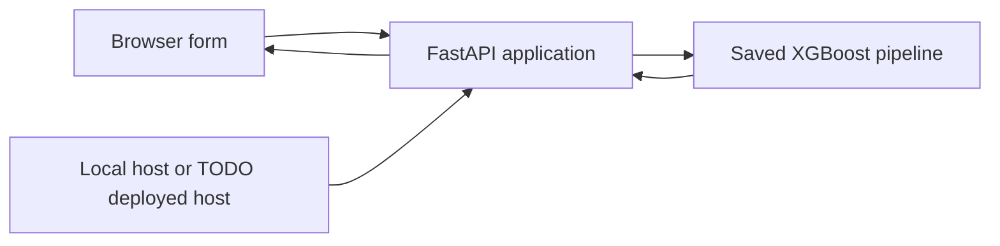

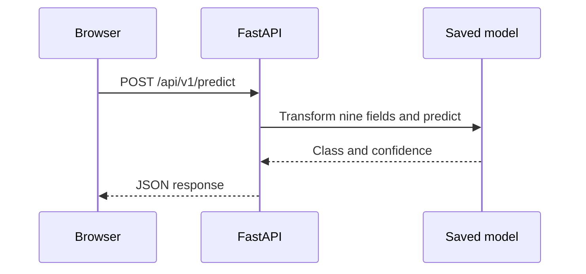

## The data

The repository contains `data/Diabetes_type.csv`. Its original source is not recorded in the repository. TODO: add the dataset source and attribution.

The file contains 1065 rows and 10 columns. The nine input features are numeric.

| API field | Dataset column | Units | API valid range |
| --- | --- | --- | --- |
| `no_of_pregnancy` | `No. of Pregnancy` | count | 0 to 20 |
| `age` | `Age` | years | 1 to 120 |
| `bmi` | `BMI` | body mass index | 10 to 70 |
| `bp_systolic` | `BP(Systolic)` | mm Hg | 50 to 260 |
| `bp_diastolic` | `BP(Diastolic)` | mm Hg | 30 to 160 |
| `diabetes_pedigree_function` | `DiabetesPedigreeFunction` | score | 0 to 3 |
| `insulin` | `Insulin` | mu U per ml | 0 to 2000 |
| `skin_thickness_mm` | `Skin Thickness(mm)` | mm | 0 to 600 |
| `glucose` | `Glucose` | mg per dl | 0 to 400 |

The target column is `Type-2 Diabetic`. The target counts are 225 rows labelled 0 and 840 rows labelled 1. The source data has four missing values in `BP(Diastolic)` and seven missing values in `Skin Thickness(mm)`.

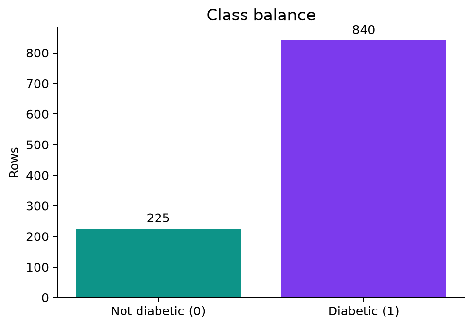

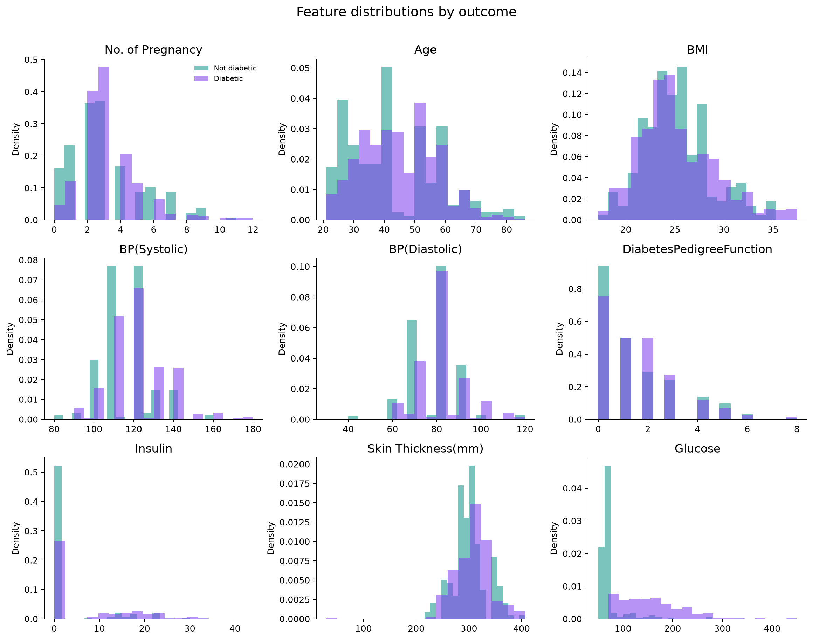

## The model

The saved model is `model/best_pipeline_XGBoost.joblib`. Its pipeline selects the nine numeric fields, imputes numeric missing values with the median, standardises numeric values, applies SMOTETomek sampling, and uses an XGBoost classifier.

## Results

The evaluation uses a stratified test split with 20 percent of the rows and random state 42.

| Metric | Test result |
| --- | ---: |
| Accuracy | 0.9624 |
| Precision | 0.9598 |
| Recall | 0.9940 |
| F1 score | 0.9766 |
| ROC AUC | 0.9274 |

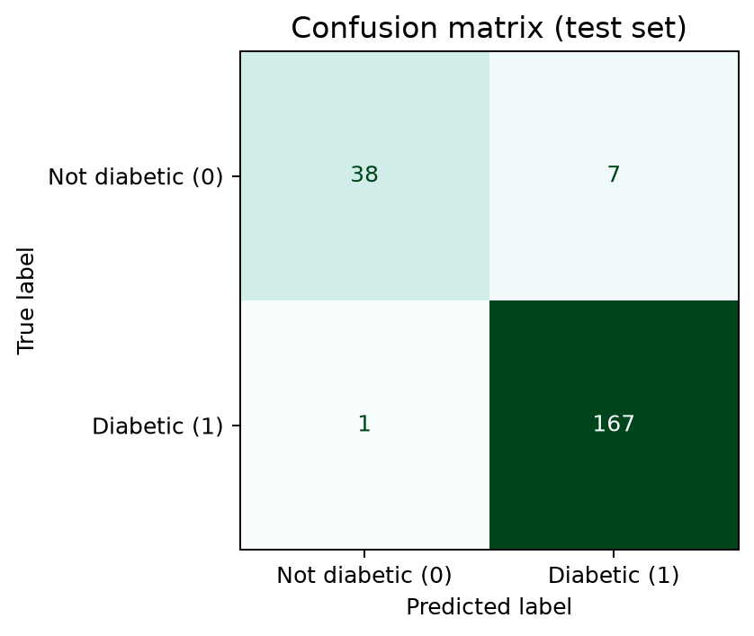

The confusion matrix shows 38 correctly predicted rows labelled 0, 7 rows labelled 0 predicted as 1, 1 row labelled 1 predicted as 0, and 167 correctly predicted rows labelled 1.

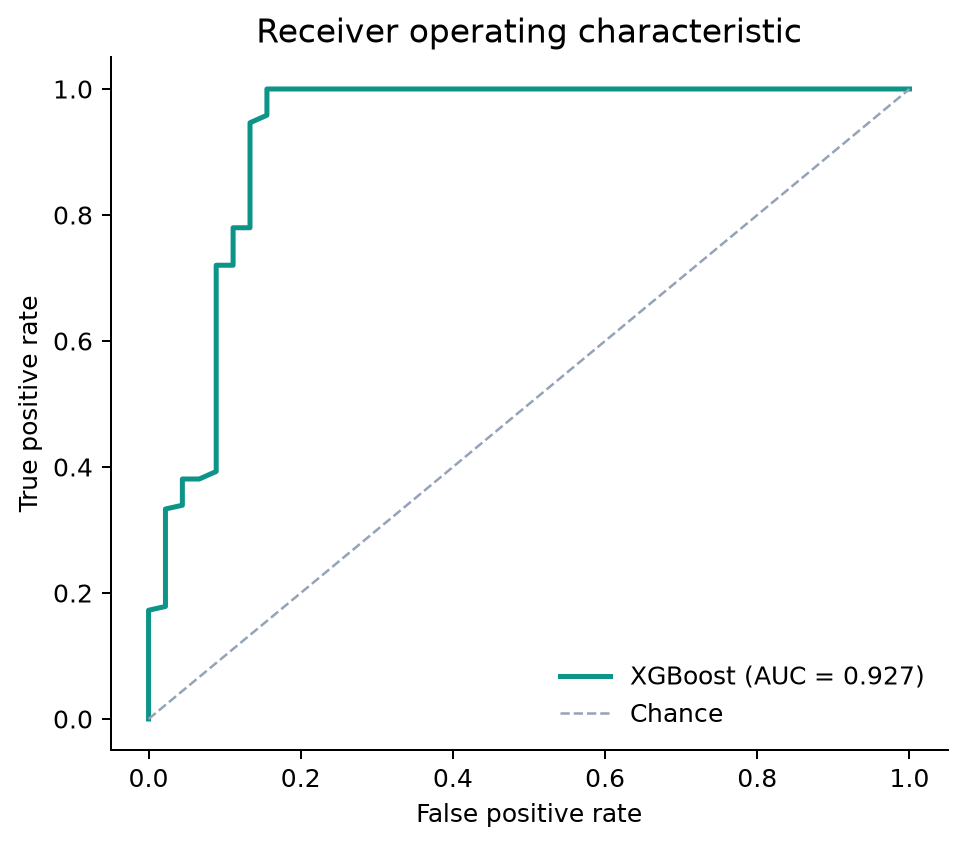

The ROC curve shows the relationship between the true positive rate and false positive rate across thresholds. Its legend reports the measured test ROC AUC of 0.9274.

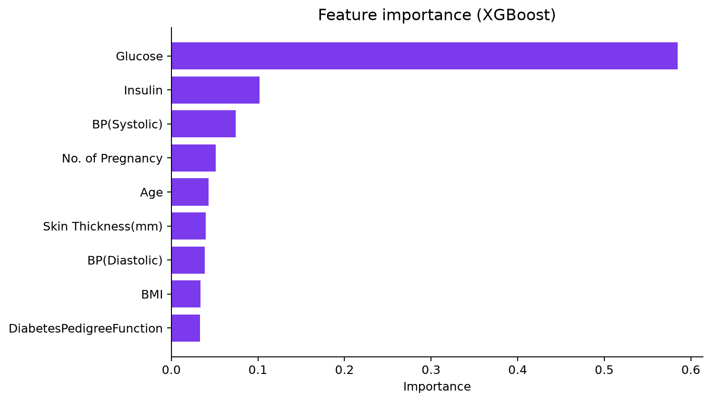

The feature importance chart ranks the input fields by their contribution in the saved XGBoost model. Glucose has the largest recorded importance, followed by Insulin and BP(Systolic).

## The API

The prediction endpoint is `POST /api/v1/predict`.

Example request:

```json
{
  "no_of_pregnancy": 3,
  "age": 50,
  "bmi": 28.5,
  "bp_systolic": 130,
  "bp_diastolic": 85,
  "diabetes_pedigree_function": 0.35,
  "insulin": 95,
  "skin_thickness_mm": 23,
  "glucose": 146
}
```

Example response shape:

```json
{
  "prediction": 1,
  "confidence": 0.97,
  "status": "success"
}
```

The prediction and confidence values depend on the loaded model and request values.

```powershell
curl.exe -X POST http://127.0.0.1:8001/api/v1/predict -H "Content-Type: application/json" -d "{\"no_of_pregnancy\":3,\"age\":50,\"bmi\":28.5,\"bp_systolic\":130,\"bp_diastolic\":85,\"diabetes_pedigree_function\":0.35,\"insulin\":95,\"skin_thickness_mm\":23,\"glucose\":146}"
```

## The interface

The single page form accepts the nine measurements and sends them to the prediction endpoint. The result card displays the predicted class and the model confidence. The page supports light and dark themes. Client side validation reports invalid or missing values before a request is sent.

The empty form

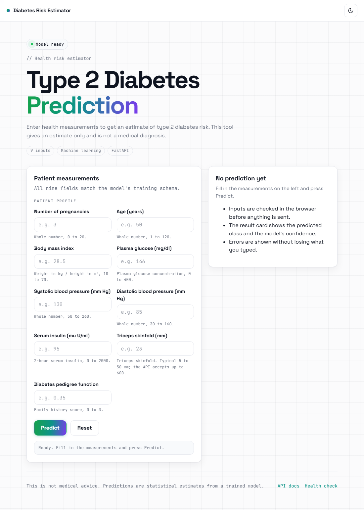

The validation error for an invalid value

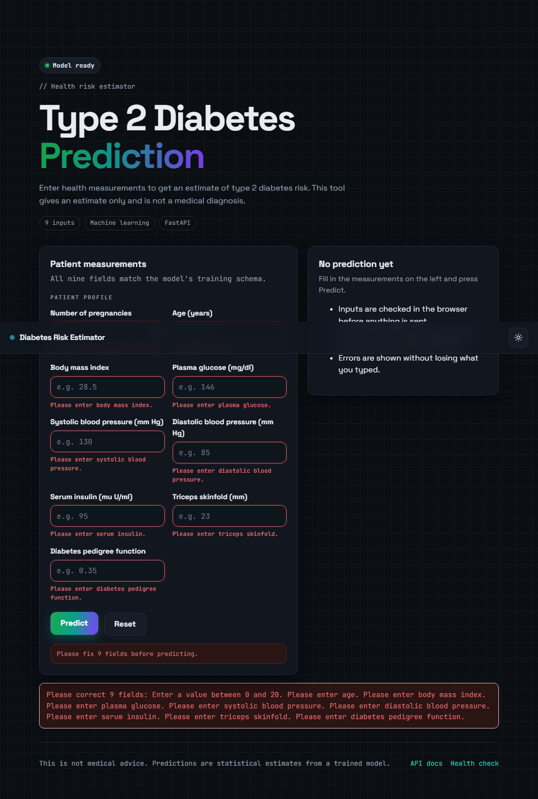

The successful prediction


## Run it locally

Create and activate a virtual environment on Windows:

```powershell
py -3.13 -m venv .venv
.\.venv\Scripts\Activate.ps1
```

Install the application dependencies:

```powershell
python -m pip install -r requirements.txt
```

Train the model only when the saved model is not available:

```powershell
python machine_learning\machine_learning.py
```

Start the server:

```powershell
python -m uvicorn apps.main:app --host 127.0.0.1 --port 8001
```

Open `http://127.0.0.1:8001/` in a browser.

Install the separate figure and capture dependencies:

```powershell
python -m pip install -r scripts\requirements.txt
python -m playwright install chromium
```

Regenerate the figures and interface captures:

```powershell
python scripts\make_figures.py
python scripts\capture_ui.py
```

## Tech stack

* Python
* FastAPI
* Uvicorn
* pandas
* NumPy
* scikit learn
* imbalanced learn
* XGBoost
* joblib
* HTML, CSS and JavaScript

## Project structure

```text
TYPE_2_DIABETES_PREDICTION
|-- apps
|   |-- main.py
|   |-- routes.py
|   |-- schemas.py
|   `-- model_loader.py
|-- data
|   `-- Diabetes_type.csv
|-- frontend
|   `-- index.html
|-- machine_learning
|   `-- machine_learning.py
|-- model
|   `-- best_pipeline_XGBoost.joblib
|-- scripts
|   |-- make_figures.py
|   |-- capture_ui.py
|   `-- requirements.txt
|-- docs
|   `-- images
|-- requirements.txt
`-- scheduler.py
```

## Limitations and next steps

* The dataset contains 1065 rows and its population and collection method are not recorded in this repository.
* The dataset source and licence need to be documented.
* The model has no clinical validation and is not suitable for medical decisions.
* The target distribution is imbalanced, with more rows labelled 1 than rows labelled 0.
* The test results come from one stratified split and do not establish performance in a new population.
* Future work could document the source, add external validation, compare additional models, calibrate confidence, and add tests for the API and interface.

## Licence and author

Licence: TODO:

Author: Cyrus Ndung'u, GitHub [Cyrusz55](https://github.com/Cyrusz55), portfolio [cyrusz55.github.io](https://cyrusz55.github.io).


